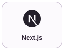
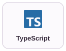
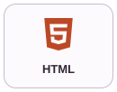
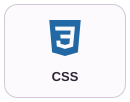
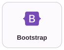
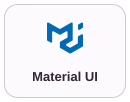
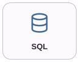

<h1><picture><source media="(prefers-color-scheme: dark)" srcset="./assets/ali-profile-loop.svg"><source media="(prefers-color-scheme: light)" srcset="./assets/light/ali-profile-loop.svg"></picture></h1>

Hi, I'm Ali 👋 For **5+ years**, I've been building web applications from the interface down to the database. I use **React and Next.js** for the parts people interact with and **PHP and Laravel** for the APIs behind them.

I like working on both sides of a feature. A good result for me is an interface that feels natural to use, backed by code another developer can pick up and extend.

### Frontend

  <a href="https://react.dev/learn" title="Open the React documentation"><picture><source media="(prefers-color-scheme: dark)" srcset="./assets/skills/react.svg"><source media="(prefers-color-scheme: light)" srcset="./assets/light/skills/react.svg"></picture></a>
  <a href="https://nextjs.org/docs" title="Open the Next.js documentation"><picture><source media="(prefers-color-scheme: dark)" srcset="./assets/skills/nextdotjs.svg"><source media="(prefers-color-scheme: light)" srcset="./assets/light/skills/nextdotjs.svg"></picture></a>
  <a href="https://developer.mozilla.org/en-US/docs/Web/JavaScript" title="Open the JavaScript documentation"><picture><source media="(prefers-color-scheme: dark)" srcset="./assets/skills/javascript.svg"><source media="(prefers-color-scheme: light)" srcset="./assets/light/skills/javascript.svg"></picture></a>
  <a href="https://www.typescriptlang.org/docs/" title="Open the TypeScript documentation"><picture><source media="(prefers-color-scheme: dark)" srcset="./assets/skills/typescript.svg"><source media="(prefers-color-scheme: light)" srcset="./assets/light/skills/typescript.svg"></picture></a>
  <a href="https://developer.mozilla.org/en-US/docs/Web/HTML" title="Open the HTML documentation"><picture><source media="(prefers-color-scheme: dark)" srcset="./assets/skills/html5.svg"><source media="(prefers-color-scheme: light)" srcset="./assets/light/skills/html5.svg"></picture></a>
  <a href="https://developer.mozilla.org/en-US/docs/Web/CSS" title="Open the CSS documentation"><picture><source media="(prefers-color-scheme: dark)" srcset="./assets/skills/css3.svg"><source media="(prefers-color-scheme: light)" srcset="./assets/light/skills/css3.svg"></picture></a>
  <a href="https://tanstack.com/query/latest/docs/framework/react/overview" title="Open the React Query documentation"><picture><source media="(prefers-color-scheme: dark)" srcset="./assets/skills/reactquery.svg"><source media="(prefers-color-scheme: light)" srcset="./assets/light/skills/reactquery.svg"></picture></a>
  <a href="https://redux-toolkit.js.org/introduction/getting-started" title="Open the Redux Toolkit documentation"><picture><source media="(prefers-color-scheme: dark)" srcset="./assets/skills/redux.svg"><source media="(prefers-color-scheme: light)" srcset="./assets/light/skills/redux.svg"></picture></a>
  <a href="https://axios-http.com/docs/intro" title="Open the Axios documentation"><picture><source media="(prefers-color-scheme: dark)" srcset="./assets/skills/axios.svg"><source media="(prefers-color-scheme: light)" srcset="./assets/light/skills/axios.svg"></picture></a>

### UI & Styling

  <a href="https://tailwindcss.com/docs" title="Open the Tailwind CSS documentation"><picture><source media="(prefers-color-scheme: dark)" srcset="./assets/skills/tailwindcss.svg"><source media="(prefers-color-scheme: light)" srcset="./assets/light/skills/tailwindcss.svg"></picture></a>
  <a href="https://getbootstrap.com/docs/5.3/getting-started/introduction/" title="Open the Bootstrap documentation"><picture><source media="(prefers-color-scheme: dark)" srcset="./assets/skills/bootstrap.svg"><source media="(prefers-color-scheme: light)" srcset="./assets/light/skills/bootstrap.svg"></picture></a>
  <a href="https://mui.com/material-ui/getting-started/" title="Open the Material UI documentation"><picture><source media="(prefers-color-scheme: dark)" srcset="./assets/skills/mui.svg"><source media="(prefers-color-scheme: light)" srcset="./assets/light/skills/mui.svg"></picture></a>
  <a href="https://sass-lang.com/documentation/" title="Open the Sass documentation"><picture><source media="(prefers-color-scheme: dark)" srcset="./assets/skills/sass.svg"><source media="(prefers-color-scheme: light)" srcset="./assets/light/skills/sass.svg"></picture></a>

### Backend & APIs

  <a href="https://laravel.com/docs" title="Open the Laravel documentation"><picture><source media="(prefers-color-scheme: dark)" srcset="./assets/skills/laravel.svg"><source media="(prefers-color-scheme: light)" srcset="./assets/light/skills/laravel.svg"></picture></a>
  <a href="https://www.php.net/manual/en/" title="Open the PHP documentation"><picture><source media="(prefers-color-scheme: dark)" srcset="./assets/skills/php.svg"><source media="(prefers-color-scheme: light)" srcset="./assets/light/skills/php.svg"></picture></a>
  <a href="https://developer.mozilla.org/en-US/docs/Glossary/REST" title="Read the REST overview"><picture><source media="(prefers-color-scheme: dark)" srcset="./assets/skills/rest-api.svg"><source media="(prefers-color-scheme: light)" srcset="./assets/light/skills/rest-api.svg"></picture></a>
  <a href="https://www.postgresql.org/docs/current/tutorial-sql.html" title="Explore the SQL tutorial"><picture><source media="(prefers-color-scheme: dark)" srcset="./assets/skills/sql.svg"><source media="(prefers-color-scheme: light)" srcset="./assets/light/skills/sql.svg"></picture></a>

### Development Tools

  <a href="https://git-scm.com/doc" title="Open the Git documentation"><picture><source media="(prefers-color-scheme: dark)" srcset="./assets/skills/git.svg"><source media="(prefers-color-scheme: light)" srcset="./assets/light/skills/git.svg"></picture></a>
  <a href="https://docs.npmjs.com/" title="Open the npm documentation"><picture><source media="(prefers-color-scheme: dark)" srcset="./assets/skills/npm.svg"><source media="(prefers-color-scheme: light)" srcset="./assets/light/skills/npm.svg"></picture></a>
  <a href="https://getcomposer.org/doc/" title="Open the Composer documentation"><picture><source media="(prefers-color-scheme: dark)" srcset="./assets/skills/composer.svg"><source media="(prefers-color-scheme: light)" srcset="./assets/light/skills/composer.svg"></picture></a>
  <a href="https://learning.postman.com/docs/" title="Open the Postman documentation"><picture><source media="(prefers-color-scheme: dark)" srcset="./assets/skills/postman.svg"><source media="(prefers-color-scheme: light)" srcset="./assets/light/skills/postman.svg"></picture></a>

### Contact Me

  <a href="https://www.linkedin.com/in/ali-saberizadeh-667899223/" title="View Ali on LinkedIn"><picture><source media="(prefers-color-scheme: dark)" srcset="./assets/contact/linkedin.svg"><source media="(prefers-color-scheme: light)" srcset="./assets/light/contact/linkedin.svg"></picture></a>
  <a href="mailto:Alisaberizadeh.one@gmail.com" title="Email Alisaberizadeh.one@gmail.com"><picture><source media="(prefers-color-scheme: dark)" srcset="./assets/contact/email.svg"><source media="(prefers-color-scheme: light)" srcset="./assets/light/contact/email.svg"></picture></a>

