<picture>
  <source media="(prefers-color-scheme: dark)" srcset="./assets/hero-dark.svg" />
  <source media="(prefers-color-scheme: light)" srcset="./assets/hero-light.svg" />
  
</picture>

# Ali Saberizadeh

### Full-Stack Developer

I build modern, responsive, and user-friendly web experiences.

 

## About me

I'm **Ali Saberizadeh**, a **Full-Stack Developer** with **5+ years of experience** building modern web applications. I currently work at **Omid Hegmataneh Pouya Novin**.

I enjoy turning ideas into intuitive digital products, writing maintainable code, and improving performance and usability.

| | |
|:---:|:---:|
| 💻 **Position** | Full-Stack Developer |
| 📍 **Location** | Tehran, Iran |
| 🎯 **Focus** | Modern web applications & clean user experiences |

## Skills

<table>
  <tr>
    <td align="center" width="16.66%"> <b>React</b></td>
    <td align="center" width="16.66%"> <b>Next.js</b></td>
    <td align="center" width="16.66%"> <b>JavaScript (ES6+)</b></td>
    <td align="center" width="16.66%"> <b>TypeScript</b></td>
    <td align="center" width="16.66%"> <b>Laravel</b></td>
    <td align="center" width="16.66%"> <b>PHP</b></td>
  </tr>
  <tr>
    <td align="center"> <b>React Query</b></td>
    <td align="center"> <b>SQL</b></td>
    <td align="center"> <b>Tailwind</b></td>
    <td align="center"> <b>Redux Toolkit</b></td>
    <td align="center"> <b>Bootstrap</b></td>
    <td align="center"> <b>Material UI</b></td>
  </tr>
  <tr>
    <td align="center"> <b>Axios</b></td>
    <td align="center"> <b>Sass</b></td>
    <td align="center"> <b>Git</b></td>
    <td align="center"> <b>REST API</b></td>
    <td align="center"> <b>HTML</b></td>
    <td align="center"> <b>CSS</b></td>
  </tr>
</table>

## What I build

| ✨ | | ✨ | |
|:---:|:---|:---:|:---|
| ⚡ | Fast, responsive interfaces | 🧩 | Reusable component systems |
| 🔗 | API-driven applications | 🎨 | Thoughtful and accessible UX |

 

<picture>
  <source media="(prefers-color-scheme: dark)" srcset="./assets/footer-dark.svg" />
  <source media="(prefers-color-scheme: light)" srcset="./assets/footer-light.svg" />
  
</picture>

Learn · Build · Improve

