<!--
  GitHub Profile README for github.com/alisaberizadeh
  Create a public repository named exactly "alisaberizadeh" to show this on your profile.
  The snake section becomes visible after .github/workflows/snake.yml runs successfully.
-->

<div align="center">

<picture>
  <source media="(prefers-color-scheme: dark)" srcset="./assets/hero-dark.svg" />
  <source media="(prefers-color-scheme: light)" srcset="./assets/hero-light.svg" />
  
</picture>

<a href="https://github.com/alisaberizadeh">
  
</a>

**React & Next.js** · **TypeScript** · **User Experience** · **Clean Code**

</div>

---

### 👨‍💻 About Me

I'm **Ali Saberizadeh**, a Frontend Developer with **3 years of experience** building modern, responsive, and user-friendly web applications.

I enjoy turning ideas into intuitive digital experiences, writing maintainable code, and improving performance and usability. I'm a self-taught developer who believes in continuous learning and staying curious about new technologies.

- 🎯 **Focus:** Responsive interfaces, performance, and seamless user experiences
- 🌱 **Currently:** Learning, building, and sharpening my frontend skills
- 🤝 **Open to:** Collaboration, exchanging ideas, and new opportunities

### 🛠️ My Skills

<!-- GitHub-compatible responsive layout: inline skill badges wrap naturally like flex-wrap. -->
<div align="center">

  
  
  
  
  
  
  
  
  
  
  
  
  
  
  
  

</div>

### 📊 GitHub Statistics

<div align="center">

<picture>
  <source media="(prefers-color-scheme: dark)" srcset="https://github-readme-stats.vercel.app/api?username=alisaberizadeh&amp;show_icons=true&amp;include_all_commits=true&amp;hide_border=true&amp;rank_icon=github&amp;bg_color=00000000&amp;title_color=8B5CF6&amp;icon_color=3B82F6&amp;text_color=E2E8F0" />
  <source media="(prefers-color-scheme: light)" srcset="https://github-readme-stats.vercel.app/api?username=alisaberizadeh&amp;show_icons=true&amp;include_all_commits=true&amp;hide_border=true&amp;rank_icon=github&amp;bg_color=00000000&amp;title_color=6D28D9&amp;icon_color=2563EB&amp;text_color=334155" />
  
</picture>
<picture>
  <source media="(prefers-color-scheme: dark)" srcset="https://github-readme-stats.vercel.app/api/top-langs/?username=alisaberizadeh&amp;layout=compact&amp;langs_count=8&amp;hide_border=true&amp;bg_color=00000000&amp;title_color=8B5CF6&amp;text_color=E2E8F0" />
  <source media="(prefers-color-scheme: light)" srcset="https://github-readme-stats.vercel.app/api/top-langs/?username=alisaberizadeh&amp;layout=compact&amp;langs_count=8&amp;hide_border=true&amp;bg_color=00000000&amp;title_color=6D28D9&amp;text_color=334155" />
  
</picture>

<picture>
  <source media="(prefers-color-scheme: dark)" srcset="https://streak-stats.demolab.com/?user=alisaberizadeh&amp;theme=github-dark-blue&amp;hide_border=true&amp;background=00000000&amp;ring=8B5CF6&amp;fire=3B82F6&amp;currStreakLabel=A78BFA" />
  <source media="(prefers-color-scheme: light)" srcset="https://streak-stats.demolab.com/?user=alisaberizadeh&amp;theme=default&amp;hide_border=true&amp;background=00000000&amp;ring=7C3AED&amp;fire=2563EB&amp;currStreakLabel=6D28D9" />
  
</picture>

</div>

### 📈 Contribution Activity

<div align="center">

<picture>
  <source media="(prefers-color-scheme: dark)" srcset="https://github-readme-activity-graph.vercel.app/graph?username=alisaberizadeh&amp;bg_color=0d1117&amp;color=cbd5e1&amp;line=8b5cf6&amp;point=38bdf8&amp;area_color=3b82f6&amp;area=true&amp;hide_border=true" />
  <source media="(prefers-color-scheme: light)" srcset="https://github-readme-activity-graph.vercel.app/graph?username=alisaberizadeh&amp;bg_color=ffffff&amp;color=334155&amp;line=7c3aed&amp;point=2563eb&amp;area_color=93c5fd&amp;area=true&amp;hide_border=true" />
  
</picture>

</div>

### 🐍 Contribution Snake

<div align="center">

<picture>
  <source media="(prefers-color-scheme: dark)" srcset="https://raw.githubusercontent.com/alisaberizadeh/alisaberizadeh/output/github-contribution-grid-snake-dark.svg" />
  <source media="(prefers-color-scheme: light)" srcset="https://raw.githubusercontent.com/alisaberizadeh/alisaberizadeh/output/github-contribution-grid-snake.svg" />
  
</picture>

</div>

<!-- The snake is generated daily by .github/workflows/snake.yml.
     It will appear after the workflow publishes the first images to the output branch. -->

### 💭 Developer Mindset

```javascript
while (alive) {
  learn();
  build();
  improve();
}
```

### 🤝 Let's Connect

I'm always open to discussing frontend development, sharing ideas, and collaborating on interesting projects.

- **LinkedIn:** [Ali Saberizadeh](https://www.linkedin.com/in/ali-saberizadeh-667899223/)
- **Email:** [Alisaberizadeh.one@gmail.com](mailto:Alisaberizadeh.one@gmail.com)
- **GitHub:** [@alisaberizadeh](https://github.com/alisaberizadeh)

<div align="center">

<picture>
  <source media="(prefers-color-scheme: dark)" srcset="./assets/footer-dark.svg" />
  <source media="(prefers-color-scheme: light)" srcset="./assets/footer-light.svg" />
  
</picture>

</div>
