<h1></h1>

Hi, I'm Ali 👋 For **5+ years**, I've been building web applications from the interface down to the database. I use **React and Next.js** for the parts people interact with and **PHP and Laravel** for the APIs behind them.

I like working on both sides of a feature. A good result for me is an interface that feels natural to use, backed by code another developer can pick up and extend.

## My Skills

### Frontend

  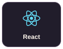
  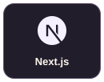
  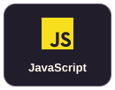
  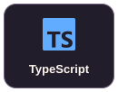
  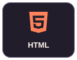
  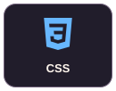

### UI & Styling

  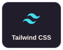
  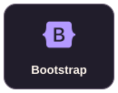
  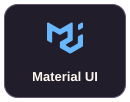
  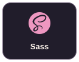

### Backend & APIs

  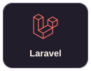
  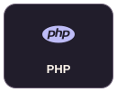
  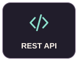

### Data & State Management

  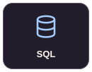
  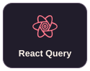
  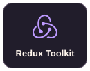
  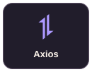

### Development Tools

  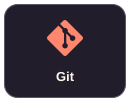

