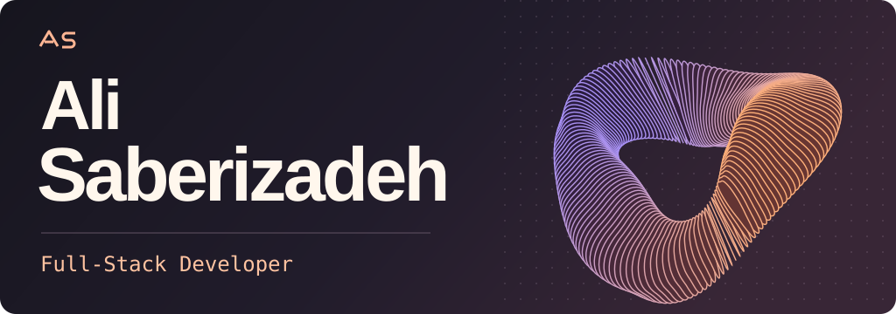

<h1></h1>

Hi, I'm Ali 👋 For **5+ years**, I've been building web applications from the interface down to the database. I use **React and Next.js** for the parts people interact with and **PHP and Laravel** for the APIs behind them.

I like working on both sides of a feature. A good result for me is an interface that feels natural to use, backed by code another developer can pick up and extend.

## My toolkit

| Area | Technologies |
| :--- | :--- |
| **Frontend** | React · Next.js · JavaScript (ES6+) · TypeScript · HTML · CSS |
| **UI & styling** | Tailwind CSS · Bootstrap · Material UI · Sass |
| **Backend & APIs** | Laravel · PHP · REST APIs |
| **Data & state** | SQL · React Query · Redux Toolkit · Axios |
| **Version control** | Git |

[Explore my repositories ↗](https://github.com/alisaberizadeh?tab=repositories)
