<h1><picture><source media="(prefers-color-scheme: dark)" srcset="./assets/ali-profile-loop.svg"><source media="(prefers-color-scheme: light)" srcset="./assets/light/ali-profile-loop.svg">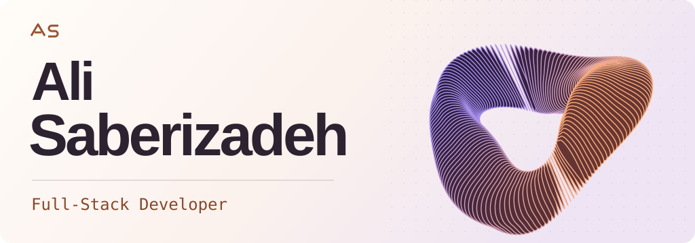</picture></h1>

Hi, I'm Ali 👋 For **5+ years**, I've been building web applications from the interface down to the database. I use **React and Next.js** for the parts people interact with and **PHP and Laravel** for the APIs behind them.

I like working on both sides of a feature. A good result for me is an interface that feels natural to use, backed by code another developer can pick up and extend.

## My Skills

### Frontend

  <picture><source media="(prefers-color-scheme: dark)" srcset="./assets/skills/react.svg"><source media="(prefers-color-scheme: light)" srcset="./assets/light/skills/react.svg">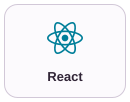</picture>
  <picture><source media="(prefers-color-scheme: dark)" srcset="./assets/skills/nextdotjs.svg"><source media="(prefers-color-scheme: light)" srcset="./assets/light/skills/nextdotjs.svg"></picture>
  <picture><source media="(prefers-color-scheme: dark)" srcset="./assets/skills/javascript.svg"><source media="(prefers-color-scheme: light)" srcset="./assets/light/skills/javascript.svg"></picture>
  <picture><source media="(prefers-color-scheme: dark)" srcset="./assets/skills/typescript.svg"><source media="(prefers-color-scheme: light)" srcset="./assets/light/skills/typescript.svg"></picture>
  <picture><source media="(prefers-color-scheme: dark)" srcset="./assets/skills/html5.svg"><source media="(prefers-color-scheme: light)" srcset="./assets/light/skills/html5.svg"></picture>
  <picture><source media="(prefers-color-scheme: dark)" srcset="./assets/skills/css3.svg"><source media="(prefers-color-scheme: light)" srcset="./assets/light/skills/css3.svg"></picture>
  <picture><source media="(prefers-color-scheme: dark)" srcset="./assets/skills/reactquery.svg"><source media="(prefers-color-scheme: light)" srcset="./assets/light/skills/reactquery.svg"></picture>
  <picture><source media="(prefers-color-scheme: dark)" srcset="./assets/skills/redux.svg"><source media="(prefers-color-scheme: light)" srcset="./assets/light/skills/redux.svg">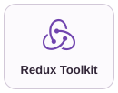</picture>
  <picture><source media="(prefers-color-scheme: dark)" srcset="./assets/skills/axios.svg"><source media="(prefers-color-scheme: light)" srcset="./assets/light/skills/axios.svg">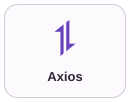</picture>

### UI & Styling

  <picture><source media="(prefers-color-scheme: dark)" srcset="./assets/skills/tailwindcss.svg"><source media="(prefers-color-scheme: light)" srcset="./assets/light/skills/tailwindcss.svg"></picture>
  <picture><source media="(prefers-color-scheme: dark)" srcset="./assets/skills/bootstrap.svg"><source media="(prefers-color-scheme: light)" srcset="./assets/light/skills/bootstrap.svg"></picture>
  <picture><source media="(prefers-color-scheme: dark)" srcset="./assets/skills/mui.svg"><source media="(prefers-color-scheme: light)" srcset="./assets/light/skills/mui.svg"></picture>
  <picture><source media="(prefers-color-scheme: dark)" srcset="./assets/skills/sass.svg"><source media="(prefers-color-scheme: light)" srcset="./assets/light/skills/sass.svg">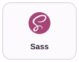</picture>

### Backend & APIs

  <picture><source media="(prefers-color-scheme: dark)" srcset="./assets/skills/laravel.svg"><source media="(prefers-color-scheme: light)" srcset="./assets/light/skills/laravel.svg">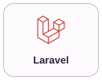</picture>
  <picture><source media="(prefers-color-scheme: dark)" srcset="./assets/skills/php.svg"><source media="(prefers-color-scheme: light)" srcset="./assets/light/skills/php.svg">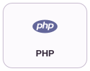</picture>
  <picture><source media="(prefers-color-scheme: dark)" srcset="./assets/skills/rest-api.svg"><source media="(prefers-color-scheme: light)" srcset="./assets/light/skills/rest-api.svg">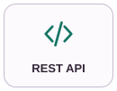</picture>
  <picture><source media="(prefers-color-scheme: dark)" srcset="./assets/skills/sql.svg"><source media="(prefers-color-scheme: light)" srcset="./assets/light/skills/sql.svg"></picture>

### Development Tools

  <picture><source media="(prefers-color-scheme: dark)" srcset="./assets/skills/git.svg"><source media="(prefers-color-scheme: light)" srcset="./assets/light/skills/git.svg">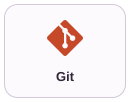</picture>
  <picture><source media="(prefers-color-scheme: dark)" srcset="./assets/skills/npm.svg"><source media="(prefers-color-scheme: light)" srcset="./assets/light/skills/npm.svg">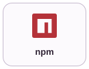</picture>
  <picture><source media="(prefers-color-scheme: dark)" srcset="./assets/skills/composer.svg"><source media="(prefers-color-scheme: light)" srcset="./assets/light/skills/composer.svg"></picture>
  <picture><source media="(prefers-color-scheme: dark)" srcset="./assets/skills/postman.svg"><source media="(prefers-color-scheme: light)" srcset="./assets/light/skills/postman.svg">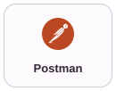</picture>

